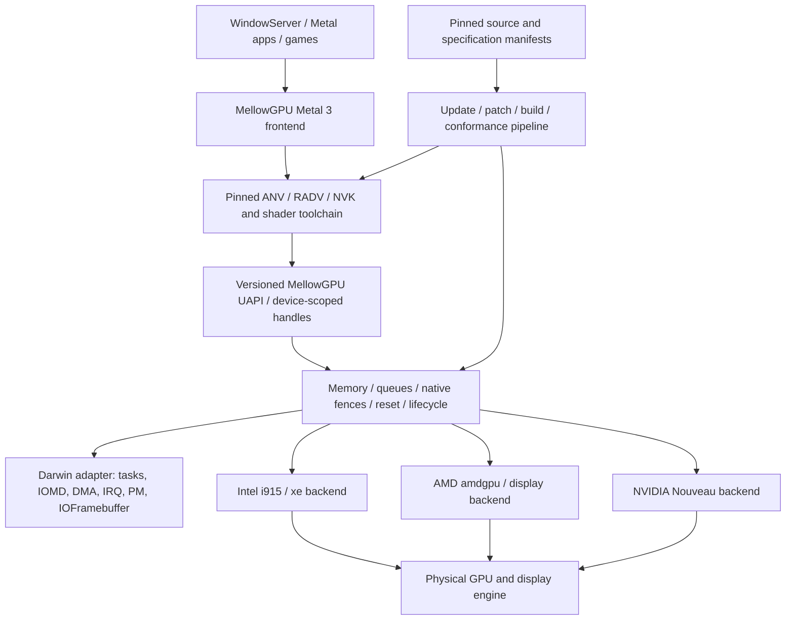

# MellowGPU architecture and conformance specification

Revision 1, 2026-10-16. This specification governs the MellowGPU remake of
NiSeullent/Mellow baseline `9ce8a56e43cba8da5a99b29e1aa7b93e57454d2d`.
Existing implementation and evidence remain available; a historical test result
does not qualify a new driver, operating-system build or upstream revision.

## Product contract

MellowGPU is a native macOS GPU driver platform for Intel, AMD and NVIDIA.
Supported devices must provide the complete selected Metal 3 programming model,
accelerated WindowServer presentation, and the application and game acceptance
corpus. CPU rasterization or CPU frame copies cannot satisfy these requirements.
CPU compilation, command encoding and control-plane bookkeeping are permitted.
Optional Metal features remain accurately conditional on the physical GPU;
Metal 3 does not imply that every optional ray-tracing or mesh feature exists.

At revision 1 there are **zero MellowGPU-qualified GPU/OS profiles**. Intel,
AMD and NVIDIA are parallel porting lanes, not blanket support claims. A GPU
that cannot meet the complete mandatory profile is ineligible, regardless of
whether PCI discovery or an offscreen triangle succeeds.

The initial supported host ABI target is macOS 15.8.1 build 24H32, x86_64.
Other macOS builds require their own native ABI and hardware records. Apple
silicon hosts may build and execute host tests; that is not proof that a PC GPU
kext can run on Apple silicon. Existing Windows GL/CL experiments remain research
assets and are not the production Metal 3 implementation.

## Selected structure

Three approaches were considered: extending per-card patches indefinitely;
one compatibility layer exposing the whole Linux kernel API; or a small common
ownership/ABI core with explicit OS and vendor adapters. The third is selected.
It keeps upstream algorithms and per-generation display/firmware behavior in
their vendor lanes while making lifetime, errors and conformance uniform.

`Runtime/` and the ported `Drivers/` assets are retained. New shared contracts
live in `Drivers/Core/`; production capability admission is separate from the
legacy GL/CL route planner. `Tools/mellow_port/` remains the source-intake engine.
The updater extends that engine rather than introducing another source factory.

## Vendor boundaries

| Lane | Kernel/source contract | Userspace contract | Promotion condition |
| --- | --- | --- | --- |
| Intel | Pinned i915 or xe, selected per exact family | Matching ANV winsys/UAPI | Metal 3 plus complete system profile |
| AMD | Pinned amdgpu and generation-specific DC/display | Matching RADV winsys/UAPI | Same complete system profile |
| NVIDIA | Pinned Nouveau and firmware policy | Matching NVK winsys/UAPI | Same complete system profile |
| NVIDIA open RM research | Separate open-gpu-kernel-modules/GSP ABI | Explicit matching userspace adapter, still unimplemented | Cannot substitute for Nouveau/NVK ABI |

A source parser, shader compiler or noop/drm-shim result never makes a lane
hardware-ready. Upstream compatibility is a tuple of kernel source, userspace
source, firmware format, OS ABI, compiler, patches and configuration. NVIDIA RM
and Nouveau handles, channels, fences and memory objects are not interchangeable.

## Shared invariants and interfaces

The shared core uses fixed-width C data at native boundaries and freestanding
C++ ownership logic. No Apple private object offsets, OS locks, sleeping waits,
Linux task structures or vendor MMIO belong in the common core. A native adapter
supplies synchronization and resource operations. Unimplemented operations return
an explicit unsupported/error status; success stubs are forbidden.

1. **Identity:** every device instance has a nonzero generation. Reset invalidates
   the old generation and every dependent queue, surface and qualification token.
   IDs from another device, session or generation are rejected before native calls.
2. **Native leases:** operations, persistent pins, submissions, publications and
   flips have separately owned leases. Closing a client does not free memory still
   referenced by native GPU or display work. Admission closes before teardown.
3. **Memory:** imported IOSurfaces must be resolved for the actual task. Retained,
   prepared descriptors, normal-RAM provenance, exact page identity, cache policy,
   format, pitch, length and DMA mapping must all agree. Shared bytes do not imply
   a shared reservation object or ordering. Physical contiguity is not assumed.
4. **Synchronization:** producer tokens refer to actual native fences in the
   authenticated producer file/context. API return, CPU booleans, synthetic VBL,
   counters or matching timestamps cannot substitute for a fence. Native fence
   publication, execution completion, display flip and retirement are distinct.
5. **Display:** framebuffer preparation cannot clear or take the boot display.
   Publication follows a successful native display commit and explicit async
   matching. Display pins survive until the matching hardware replacement/IRQ.
   Timeout or unknown flight quarantines the whole pinned tuple; it does not free it.
6. **Power and termination:** never hold an adapter lock across a blocking Linux
   transition or an external family callback. Pending work uses supported IOKit
   deferred termination and asynchronous PM acknowledgement. Device detach and
   module unload require drained operations and persistent native references.
7. **Time:** every timeout specifies its clock domain and whether it is absolute
   or relative. Darwin clock and errno translations are tested at the boundary.
8. **Capability:** immutable release evidence is tied to the exact compatibility
   tuple. An application cannot grant a capability by supplying a flag or record.
   Host policy tests validate policy only; they cannot create hardware evidence.

The first implementation exposes these lifetime/admission invariants in a host
testable core. Its model callbacks deliberately do not touch hardware. Native
backends must implement and qualify the same contracts before device publication.

## Metal 3 and system conformance

The normative sources are the pinned Apple Metal programming-model/family
documentation, feature tables and shading-language specification. A profile pins
the actual document revision and digest, applicable limits, API inventory and
test-corpus digest. API availability and hardware family capability are recorded
separately. A document update invalidates only the affected assumptions, but
cannot silently keep the old profile qualified.

All the following gates are mandatory for a supported release profile:

| Gate | Required evidence |
| --- | --- |
| Native identity | Physical PCI identity, actual loaded modules, OS/kernel collections, firmware/configuration and source hashes |
| Metal 3 API and shaders | Required API/feature/limit corpus, genuine shader compilation and GPU results, exact runtime and backend identity |
| Resources and ordering | Native buffers/textures/heaps, storage/hazard semantics, cross-process IOSurface sharing, real fences, zero CPU pixel transfers |
| WindowServer | Actual compositor device selection, GPU composition, repeated native scanout/flip verification, no silent software or copy route |
| Applications | Versioned AppKit/CoreAnimation, image/video and browser application corpus, visual correctness, native completion, error and crash records |
| Games | Versioned Metal workload corpus covering compute/render/blit, bindings, synchronization, presentation and required shader semantics |
| Lifecycle | Repeated reset, fault, process exit, sleep/wake, display change and termination tests with bounded recovery and retained unknown-flight memory |
| Performance | Same-device/OS/workload paired baseline, GPU/CPU timings, frame-time percentiles, copy counts and memory pressure; no performance claim without measurement |

Feature/API inventory completeness is itself a gate; a small successful subset
cannot be called full Metal 3. Hardware evidence is produced by trusted native
test runners and independently reviewed against raw output. The core policy
engine only checks correlation and completeness; it is not an attestation source.

## Upstream and specification update pipeline

`porting/upstreams.lock.json` records component role, canonical remote, full commit,
tracking ref, source paths and Git blob/content digests, license/provenance,
patch/configuration series, ABI family and consumers. Reference-only NullMoth
and Cobalt64 entries cannot become linked dependencies through an update.

The pipeline is: discover candidate revisions -> verify commit and blob membership
-> compute source/spec/config/license/firmware/ABI changes -> reapply patches
exactly -> regenerate reviewed interfaces -> build every affected vendor/OS tuple
-> host and negative tests -> native import/link checks -> hardware conformance
-> atomic qualification promotion. Failed/unknown gates retain the last qualified
tuple and publish a candidate report. Downloaded scripts are never executed by
discovery or source verification. Mutable refs alone are not reproducible inputs.

Initial updater implementation provides strict lock validation, Git membership
verification and candidate discovery through existing intake. Automated build and
candidate reporting can run in CI. Production promotion remains unavailable until
native hardware runners and their acceptance records exist; no automatic update
may mark untested hardware supported or install a new system driver.

## Packaging, migration and release rules

The active product becomes `MellowGPU.kext`, executable `MellowGPU`, identifier
`com.NiSeullent.MellowGPU`. Active build, validation and CI packaging must agree.
Old Mellow evidence and releases keep their original identities. New installation
instructions replace the old bundle rather than loading both together.

Every development release contains its exact source commit, build/toolchain
records, checksums, retained licenses/notices, implementation status and an empty
or explicitly qualified device matrix. Buildable development artifacts may ship
as prereleases; they must state that native full acceleration is unqualified.
Stable supported releases require all gates above. GitHub publication never
substitutes for native acceptance or silently changes the current test laptop.

Existing TSNPL and per-file licenses remain controlling. NullMoth is an architectural
reference under its own PolyForm license; its source is not copied into this
remake. Cobalt64 and each third-party dependency retain their own notices.
Actual linked source closure and per-file licenses must pass the selected build
profile; a process or module boundary alone is not a licensing decision.

## Primary references

- [NullMoth v2.0.2 source](https://github.com/nullmoth/nvidia-macos-driver/tree/d96eaca3f47e748ce5b1f5fa3913a85e48f1f5fb).
- [Cobalt64 source](https://github.com/Almosst-DEV/Cobalt64/tree/d1f7bad8408a0a2c016b067c477422975a59de44).
- [Apple Metal 3 family](https://developer.apple.com/documentation/metal/mtlgpufamily/metal3),
  [Metal resources and specifications](https://developer.apple.com/metal/resources/).
- [DRM memory and synchronization contracts](https://docs.kernel.org/gpu/drm-mm.html),
  [atomic KMS helpers](https://docs.kernel.org/gpu/drm-kms-helpers.html).
- [Apple IOService source](https://github.com/apple-oss-distributions/xnu/blob/main/iokit/Kernel/IOService.cpp).
