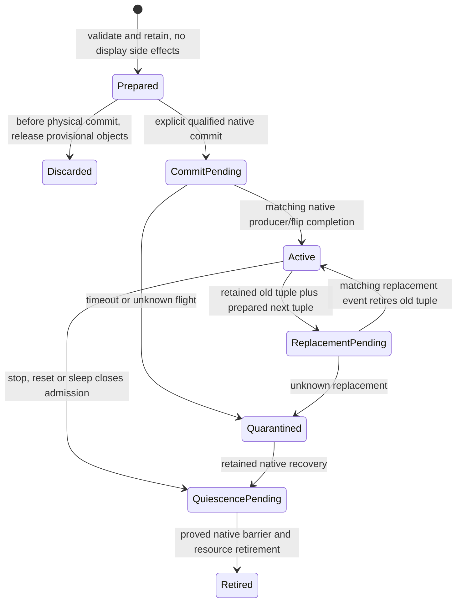

# ADR 0003: Transactional display ownership and retained retirement

Date: 2026-10-16. Status: selected lifecycle contract; native MellowGPU display
owner/adapter not yet qualified. Requirements: `MG-DISPLAY-001`,
`MG-CORE-LIFETIME-001`, `MG-CORE-SYNC-001`, `MG-OS-XNU-001`, `MG-RECOVERY-001`.

## Context and alternatives

A GPU can execute offscreen while the firmware still owns the visible display.
Conversely, a black replacement surface can be published before the compositor
has produced a frame. A timer callback, successful atomic-commit return and a
retained framebuffer object each establish less than a completed, safely pinned
hardware flip. Process exit, PM and driver termination can race that boundary.

| Alternative | Benefit | Failure mode / decision |
| --- | --- | --- |
| Claim the framebuffer category and modeset during device attach | Simple straight-line bring-up | May replace a working display before rendering/system integration is ready; rejected as default admission |
| Keep firmware output while validating an offscreen renderer | Reduces intended display effects | Vendor initialization can still alter display/power state; render-only publication is not a proof of preservation or rollback |
| Prepare provisional OS/display objects, then explicit owned commit and matched retirement | Separates allocation/publication failures from physical transition; makes retained resources observable | Requires native commit, display-pin, completion, prior-state and stop/PM integration; selected |
| Mirror pixels through CPU copies/software rendering | Easy diagnostic visibility | Cannot qualify full GPU WindowServer acceleration or zero-copy presentation |

## Ownership model

The render owner grants an authenticated surface generation, resource ownership
and a retained producer-fence token. Import validates task authority, memory
provenance, all pages, format, pitch, dimensions, ranges, cache policy and native
DMA binding. Same pages in two GEM objects do not transfer reservation/fence
state; the display consumer must import the actual producer readiness contract.
Linux [shared-buffer/fence semantics](https://docs.kernel.org/gpu/drm-mm.html) and
[atomic KMS lifetime](https://docs.kernel.org/gpu/drm-kms.html) guide the port but
are not available XNU services by declaration alone.

An owned scanout tuple contains the native framebuffer, GEM/import backing,
prepared descriptors and surface owner, **independent native display/GGTT pin
lease**, pending commit/fence/event identity, reset/surface generation and native
OS/display owner references. Retaining framebuffer/GEM alone is insufficient:
a native helper's flip timeout/cleanup may release a VMA pin independently.

These are conceptual display states, not additional implemented core enums.
Prepare does not clear pixels, change modes, write display registers, change
DPMS/PWM or register the public framebuffer. The native provisional IOKit setup
must be retained and complete before hardware commit. Public IOFramebuffer
matching follows the explicit successful native transition/eligibility policy;
publication itself is not evidence of scanout or a Metal capability.

A commit return means at most that the native operation accepted its request.
The backend must establish the exact flip/producer completion semantics before
marking the new tuple active or releasing the old one. Matching includes device,
owner/reset epoch, surface generation, connector/CRTC and submission identity.
A soft VBL or unrelated IRQ cannot discharge it. Unknown flight quarantines the
whole tuple and all pin leases. No retry, DPMS reset or foreign-firmware restore
is fabricated as a successful fallback.

## Stop, power and recovery

Close new render/display/publication admission before a transition. Drain active
native/publication calls, retain GPU/display pins through the actual native
quiescence attempt, then retire obligations explicitly. Complete detach/unload
only after persistent refs and owned callbacks are drained. A callback never
runs while the owner state lock is held. Reentrant termination needs a supported
native deferred continuation retaining the actual owner; a void stop return or
self-worker wait cannot prove it is safe to detach. PM acknowledges only its
actual asynchronous completion, never a no-op success.

Sleep/wake, reset and unplug invalidate affected resource/queue/surface epochs;
new submissions cannot reuse pretransition handles. Recovery captures original
failure and incomplete completion honestly. Restoring a foreign firmware display
requires a separately proved prior-state restoration path; the prototype must
not claim one merely because provisional objects can be discarded.

## Acceptance

Fault injection covers each prepare/commit/publication/stop boundary and races
with worker completion; unknown paths retain all obligations without a freed
mapping. Real hardware tests must prove producer-fence correlation, replacement
IRQs and pinned backing lifetime, native modeset/EDID/hotplug, repeated presents,
frame pacing and declared connector/color capabilities. System acceptance needs
actual WindowServer GPU composition, cross-process IOSurface, multimonitor and
resolution transitions where advertised, sleep/wake, recovery and the named
application/game corpus. HDR/VRR/color modes are separate conditional features.
No result from these policy tests alone qualifies a display or Metal device.
