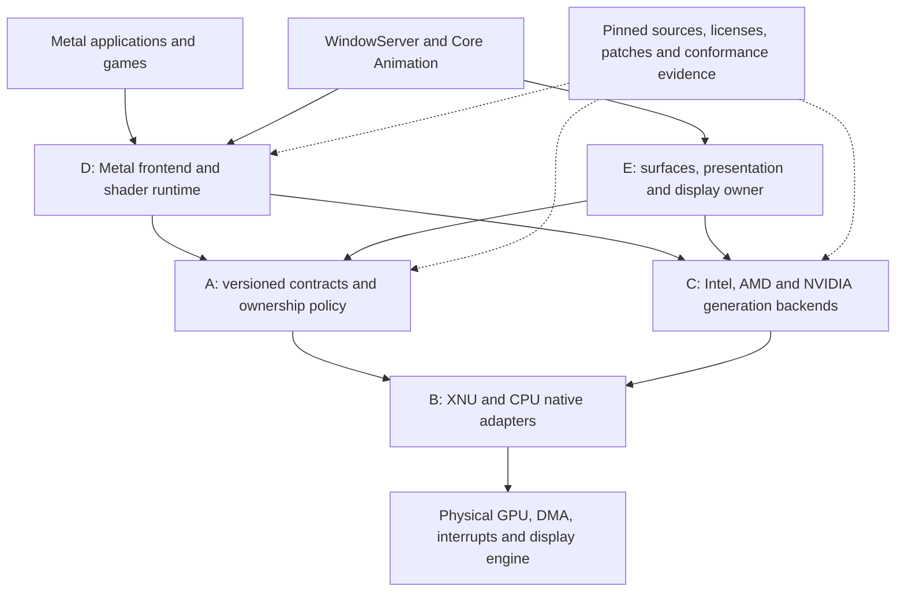

# MellowGPU architecture

Status: selected research architecture and initial implementation contract. Revision 2,
2026-10-16. **No GPU/OS/CPU tuple is qualified for full Metal 3 or WindowServer.**
This document implements the formal A–E responsibility split. The requirements
and acceptance rules in [the product specification](MELLOWGPU-SPEC.md) remain
binding; [platform support](platform-support.md) states which assumptions are
established. Earlier MGAL, MellowKPI, GL/CL and Xe documents remain historical
research inputs, not proof that the new native composition exists.

The product outcome is hardware Metal 3, actual GPU WindowServer composition,
and a published, versioned application/game compatibility corpus. A framebuffer,
host GL/CL wrapper, shader parser or successful command packet is an intermediate
result. No object implementing only a selector subset may be advertised as a
supported system Metal device. Optional features follow the selected physical
GPU family; neither every optional feature nor every application is promised.

## Five layers and dependency direction

The arrows express a required dependency, not an implemented call path. A is a
shared contract, not a hardware abstraction that pretends all GPUs are alike.
C and E may expose typed vendor extensions. Every extension has an explicit
capability, input validation, lifetime and unsupported result; the common path
must not silently discard fields it cannot represent. Upstream intake and
qualification surround all five layers rather than forming a pretend runtime
GPU layer.

| Layer | Owns | Must not infer | Initial implementation/evidence |
| --- | --- | --- | --- |
| A: contracts and policy | ABI versions, handles, sessions/epochs, resource/queue identities, leases, quotas, errors and qualification gates | A policy record is authenticated hardware evidence | `Drivers/Core/DeviceLifecycle.hpp`, `MellowGPUABI.h`, `ControlProtocol.hpp`, `Metal3Profile.hpp`; host-tested policy |
| B: OS and CPU | Native task authority, PCI identity, IOMD/CPU memory, future DMA/IOMMU, IRQ, waits, power and owner teardown | Linux execution services exist because their headers compile | `Mellow/MellowGPUDevice.*` implements an opt-in passive CPU-storage control service; GPU effects are absent |
| C: hardware | Per-vendor/per-generation initialization, firmware, VM, queues, native fences, reset and power sequences | One packet format admits every PCI device from that vendor | Intel, AMD and NVIDIA lanes develop in parallel; individual packet/model results remain software-only |
| D: userspace execution | Metal object semantics, command/resource validation, compiler adapters, vendor lowering and shader caches | Matching Objective-C selectors, Vulkan support or AIR parsing equals Metal 3 | SDK inventory and historical facades exist; complete native Metal frontend and driver registration remain unqualified |
| E: desktop/display | IOSurface ownership, producer/consumer ordering, compositor connection, modeset/EDID, hotplug, vblank/flip, scanout leases and pacing | Render completion or a synthetic VBL means a frame was displayed | Required design below; no MellowGPU-qualified WindowServer/scanout path |

## A. Common contracts and policy

`MG-CORE-ABI-001` requires fixed-width, versioned native boundaries with exact
sizes, checked offsets, byte order, reserved-zero fields and feature negotiation.
Wire records contain opaque handles and bounded byte ranges, never kernel
pointers or native C++ objects. The initial 64-byte request / 128-byte reply in
[the control ABI](MELLOWGPU-NATIVE-CONTROL.md) is specifically CPU storage. Its
five operations cannot be repurposed as a GPU VM, arbitrary ioctl, command or
physical-memory interface. New GPU operations require a reviewed ABI revision.

`MG-CORE-LIFETIME-001` binds a handle to its device owner, session and generation,
with nonwrapping object IDs. Control-service incarnation and physical GPU reset
are different epochs: the current passive service records its unique IOService
registry ID and does not observe another driver's reset. A future exclusive GPU
owner must supply native reset invalidation before GPU admission. A transferred
connection does not transfer the original task's authority.

A lease represents a particular obligation: native control operation, persistent
pin, submitted work, publication or display ownership. The native owner retains
its OS objects as well as the policy state. Closing admission prevents new work;
it does not retire old DMA or revoke an outstanding display pin. The externally
serialized lifecycle core invokes no callbacks and provides no hardware barrier.
Its two-stage recovery contract is:

1. Close admission and drain native-operation/publication calls.
2. Retain submission, pin and display obligations while a backend attempts a
   native quiescence barrier. Waiting for those leases before stopping unknown
   DMA would create a recovery deadlock.
3. A known-quiescent result acknowledges the barrier only. Retire each resource
   using its native completion/revocation proof; complete stop or advance the
   reset generation only when all required leases are retired.
4. Unknown flight retains the plan and resources. A known failed control attempt
   may end that control plan only when no asynchronous control operation remains;
   it neither frees GPU resources nor reopens admission. Reentrant stop/loss
   supersedes an older plan's authority.

`MG-CORE-SYNC-001` separates validation, API acceptance, native submission,
producer-fence publication, execution completion, display completion and resource
retirement. Errors distinguish invalid input, unsupported operation, stale owner,
permission failure, capacity, device loss and unknown completion. Unknown is
never success and does not authorize automatic resubmission of a possibly issued
command. Deadlines specify their clock and absolute/relative semantics; retries
preserve one deadline after a checked conversion into the native clock domain.

Capabilities have two domains: implemented development operations, and qualified
product features. CPU storage may report its real operations without granting a
Metal family. Product admission consumes independently reviewed, tuple-bound
native evidence; neither an app-supplied flag nor a passing policy test can
manufacture it. The current full-system inventory and native authority remain
incomplete, and the supported-device set is empty.

## B. OS and CPU adapters

`MG-OS-XNU-001` makes the adapter responsible for actual locks, task references,
CPU scheduling contexts, mapping ownership, interrupts, clock/errno conversion,
power callbacks, native object references and teardown. Sleepable operations do
not run under spinlocks; callbacks are not invoked under an owner lock. A reset
or power request closes admission, transfers a retained operation to its worker,
and uses a supported completion/acknowledgement path. A same-worker stop cannot
pretend that its own still-running callback has drained.

The initial native binding is IOKit on x86_64/Darwin 24. Public PCI reads and
private task-scoped CPU mappings already have production-source shim tests and
native build/export checks. That is not device takeover or native target
execution. GPU DMA requires an independently owned native mapping with an
explicit device/domain, permissions, address width, alignment, coherency and
retirement rule. CPU VA, physical address, IOVA and GPU VA are different types;
no integer cast supplies the missing authority.

PCIDriverKit is a genuine userspace PCI driver route on Intel and Apple silicon,
subject to the required entitlements. It is a feasibility alternative, not a
proven Metal/WindowServer backend. This research has not established a public
end-to-end third-party GPU-provider registration contract for it.
[Apple PCIDriverKit](https://developer.apple.com/documentation/pcidriverkit),
[entitlement requirements](https://developer.apple.com/documentation/driverkit/requesting-entitlements-for-driverkit-development).
Native signed IOKit research remains conditional on exact exports and family
ABIs, appropriate signing/approval, and an explicitly designated recoverable lab.
An ad hoc signature verifies package integrity, not Apple approval or loadability.
See [ADR 0001](adr/0001-core-and-platform-boundaries.md).

`MG-CPU-X64-001`, `MG-CPU-ARM64-001` and `MG-CPU-ARM64E-001` are independent
admissions. CPU memory ordering, MMIO access, cache maintenance, interrupt entry
and calling conventions belong in separate adapters. An arm64 userspace test or
universal executable cannot qualify an arm64e kernel extension. Exact virtual
method declarations, Objective-C/C++ ownership and authenticated function-pointer
boundaries require native target verification; guessed vtable layouts, raw
pointer serialization and stripping PAC to force a call are excluded.

## C. Parallel vendor and generation backends

| Requirement | First selected source route | Responsibility retained in that lane |
| --- | --- | --- |
| `MG-GPU-INTEL-001` | GLK target: i915 + ANV; Xe is a separate later-generation route | Firmware/platform rules, GGTT/PPGTT, engine context and submission, reset, display/PPS and power sequencing |
| `MG-GPU-AMD-001` | amdgpu generation adapters + RADV | GC generation, VM/GEM/TTM adaptation, firmware, queue/fence semantics and generation-specific DC/display |
| `MG-GPU-NVIDIA-001` | Nouveau + NVK/NAK as one route; open RM/GSP as a separate route | PCI/architecture identification, memory/channel/fence semantics, firmware and display/power; RM and Nouveau objects are not interchangeable |

The initial physical target is **Lenovo 15IGL7, Celeron N4120, Intel 8086:3185,
revision 06, subsystem 17AA:3E77, macOS 15.8.1/24H32, x86_64**. Its graphics
route is Gemini Lake i915/ANV. The retained Intel `7D41` Xe work does not describe
this device. CPU priority means validating the three GPU lanes first on x86_64
hosts, not serializing all development behind the Intel GPU lane.

Pinned Linux and Mesa algorithms are not an installed Linux runtime. Each
consumed facility is classified as direct dependency, port, patch set,
behavioral reference or test oracle, with a per-file license and source hash.
Native implementations must replace or explicitly satisfy Linux task/IRQ,
workqueue, lock/preemption, DMA, GEM/TTM, dma-buf and dma-fence assumptions.
Compatibility helpers cannot report success while omitting their ordering or
lifetime effect. Kernel-source, Mesa winsys/UAPI, compiler, firmware and patch
configuration form one reviewed compatibility tuple.

The current lock records Linux revision
`0d9ff90a5422cc7509258aaaba1e7481df4d332a` and Mesa revision
`f5cb8ee032adabef599ae892ec4e42d796b84da9`. A lock entry is an input pin, not a
build or hardware qualification. NullMoth/Cobalt64 remain explicit reference
inputs under their recorded file-level license review; historical success from
another project cannot promote this implementation.

## D. Metal frontend, compiler and execution

The selected development route is a MellowGPU-owned Metal semantic frontend
with a versioned vendor execution interface. Reuse ANV/RADV/NVK and their
compilers where their semantics and native winsys can be proved; retain a direct
vendor path when measured correctness or required features justify it. Do not
interpose the public Metal API over Vulkan and assume that driver registration,
resource hazards or WindowServer become available. The translation and direct
alternatives, cost and promotion gates are in [ADR 0002](adr/0002-metal-frontend-route.md).

AIR input is bound to SDK/tool build, target, language/dialect and compiler
adapter. Unknown bitcode records, metadata, intrinsics, address spaces or
relocations are typed compilation failures. Runtime MSL compilation must have a
separately verified and appropriately licensed compiler route; the presence of a
private compiler symbol or an LLVM version number does not supply it. Shader
cache keys include input bytes, semantic options, frontend/backend revisions,
GPU generation, firmware ABI and target contract. A cache hit does not bypass
validation after a reset, update or compiler change.

Four actual x86_64 Objective-C selector encodings have now been recorded on
24H32. They locate a native investigation boundary, not an implementation of it;
[platform support](platform-support.md#observed-metal-metadata) records their
scope. No private initializer was invoked, no driver object was fabricated and
no GPU result follows from that metadata. Unsupported selectors/resources must
return a real error before command acceptance. The historical MMA/MRA GL/CL
facades remain separate experimental APIs, with no system-device or full-family
advertisement. Undocumented descriptor equality cannot replace explicit
validation of every supported field or justify ignoring unobserved attachments.

## E. Desktop, surfaces and display

`MG-DISPLAY-001` requires a dedicated display owner connected to the render owner
through authenticated resources and native fences. E owns modeset/EDID,
connector/hotplug state, swapchain generations, vblank/flip completion, frame
pacing and presentation to WindowServer/Core Animation. Render may be tested
without publication; that does not prove that vendor initialization preserved
firmware scanout. Display and render share power/reset dependencies through
leases, not global booleans.

A surface import establishes actual task/resource authority, normal-RAM or
explicit device-memory provenance, complete page identity, size/pitch/format,
cache policy and native DMA mapping. Sharing pages does not merge the producer
and scanout objects' reservation/fence state. A producer token must resolve to
the actual native submission fence on the same authenticated device/context and
surface generation. The display acquire fence and matching replacement/flip
retirement are separate native obligations. The Linux contracts provide useful
reference semantics, not services present in XNU:
[DRM memory management and shared buffers](https://docs.kernel.org/gpu/drm-mm.html),
[DRM KMS/atomic display](https://docs.kernel.org/gpu/drm-kms.html).

Preparation allocates and validates without clearing a live display, programming
a pipe, toggling DPMS/PWM or publishing an IOFramebuffer. A retained provisional
IOKit object is set up before an explicit native commit. Commit acknowledgement
is not a hardware flip. The old tuple and an independent display/GGTT pin lease
remain owned until a matching native completion proves replacement. A retained
framebuffer/GEM reference alone cannot prove that a helper did not unpin the
scanout VMA after a flip-wait timeout. See [ADR 0003](adr/0003-display-ownership.md).

WindowServer eligibility additionally needs actual compositor selection and
GPU composition, cross-process IOSurface/fence tests, sustained native presents,
application/game workloads and recovery on the exact tuple. A present callback,
synthetic timer, display image, GPU clock counter or CPU-filled surface alone
cannot satisfy this gate. Hidden CPU rendering or frame staging is a failure;
explicit upload/readback tests are separately accounted and cannot establish a
zero-copy presentation claim. HDR, VRR, color management, multimonitor and
sleep/wake are individually conditional capabilities with their own tests.

## Initial vertical path and current limits

The next physical path on 15IGL7 is: passive verified PCI/session query -> native
resource owner and GPU mapping -> bounded i915 queue/fence -> actual GLK shader
with measured completion/results -> authenticated IOSurface producer/consumer
ordering -> explicit display commit/retirement -> system Metal/WindowServer
integration and the complete profile. Each step keeps the previous evidence
category; no earlier step grants a later capability.

The current repository provides policy, control/storage, parser/compiler and
packet/model building blocks. It does not yet provide a qualified native GPU
queue/VM/display/Metal composition. First failures must be attributable to the
specific boundary, with unknown flight retained and no fabricated completion.
`MG-RECOVERY-001` also forbids automatic repetition after an uncertain hardware
operation. Development-Mac EFI, boot disk, SIP, AMFI, Secure Boot and kernel
policy are outside this work's permitted mutations; hardware loading needs a
separate designated-lab plan and verified recovery route.
